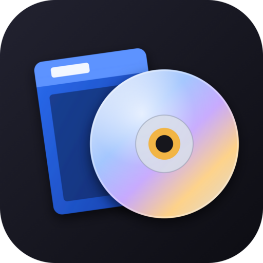
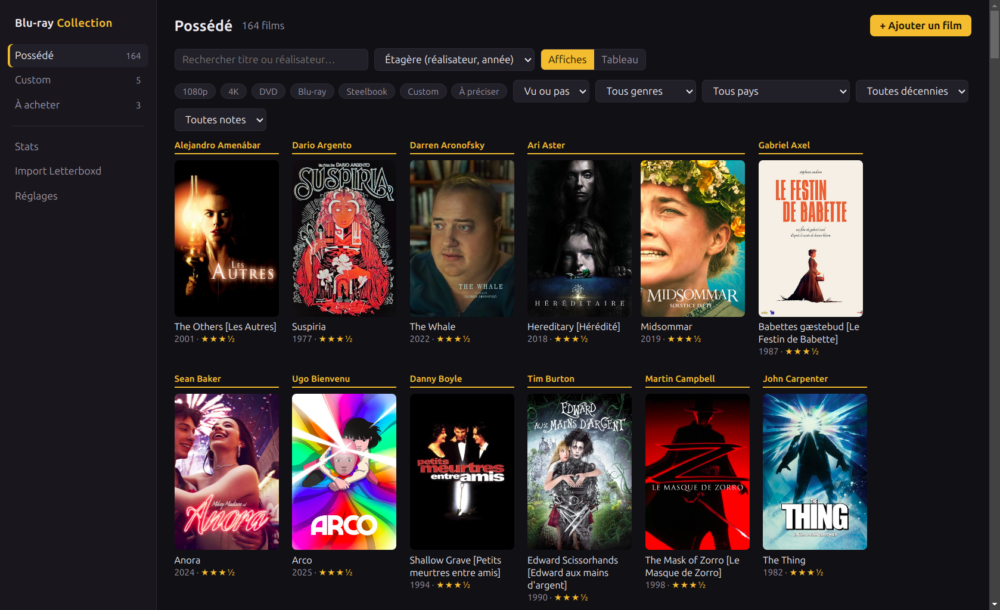
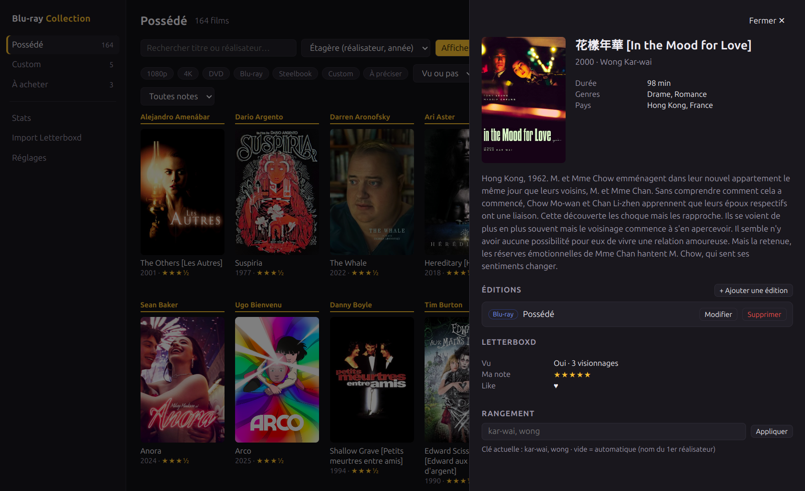
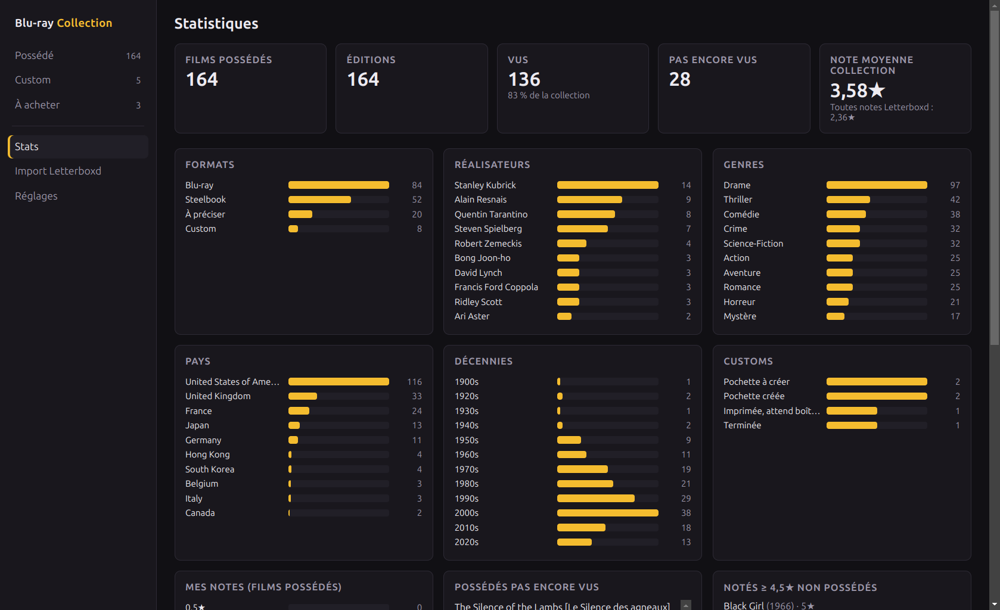
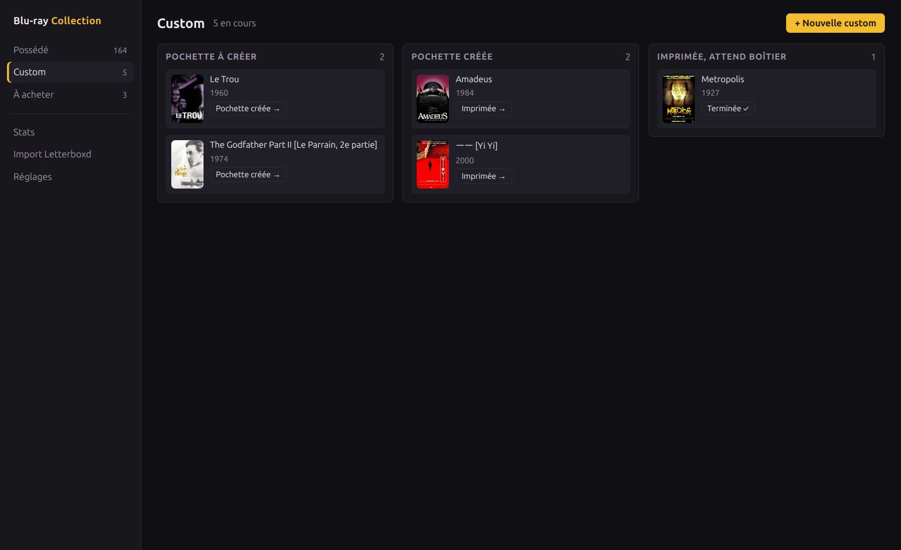
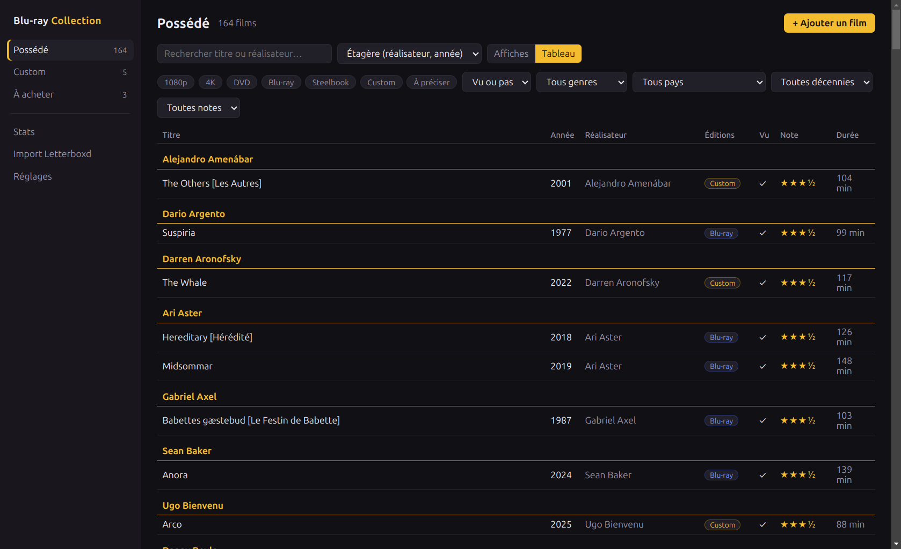

<h1 align="center"><br>Blu-ray Collection</h1>

<p align="center">
  Gère ta <b>collection physique de films</b> — Blu-ray, 4K, DVD, steelbooks et jaquettes custom.<br>
  Fiches enrichies par <a href="https://www.themoviedb.org">TMDB</a>, croisées avec tes données <a href="https://letterboxd.com">Letterboxd</a>. Local et hors-ligne.
</p>

<p align="center">
  <a href="https://github.com/M-1u/bluray-collection/releases/latest"></a>
  
  <a href="LICENSE"></a>
  
</p>

<p align="center">
  <b>🇫🇷 Français</b> · <a href="README.en.md">🇬🇧 English</a>
  &nbsp;•&nbsp;
  <a href="https://github.com/M-1u/bluray-collection/releases/latest"><b>⬇️ Télécharger</b></a>
  &nbsp;•&nbsp;
  <a href="https://m-1u.github.io/bluray-collection/">🌐 Site</a>
</p>

<p align="center"></p>

## Captures d'écran

| La fiche d'un film | Les statistiques |
| :---: | :---: |
|  |  |
| **Les jaquettes custom** | **La vue tableau** |
|  |  |

## Fonctionnalités

- **Trois listes** — **Possédé** (ta collection), **Custom** (les jaquettes que tu fabriques) et **À acheter** (tes envies).
- **Plusieurs éditions par film** — un même film peut être possédé en Blu-ray et voulu en 4K. Formats : 1080p, 4K, DVD, Blu-ray, Steelbook, Custom.
- **Rangé comme ton étagère** — tri par nom de famille du réalisateur puis par année, avec un intercalaire par réalisateur. Une clé de rangement manuelle corrige les cas particuliers (Wong Kar-wai, Bong Joon-ho…).
- **Titres** affichés `Titre original [Titre français]`.
- **Suivi des customs** — pochette à créer → créée → imprimée, en attente de boîtier → terminée. Une custom terminée rejoint automatiquement ta collection.
- **Ajout en deux clics** depuis TMDB : affiche, réalisateurs, genres, pays, durée, synopsis. Les affiches sont mises en cache sur ton disque.
- **Import Letterboxd** — importe le zip d'export de Letterboxd quand tu veux : vus, notes, critiques, likes et watchlist sont **remplacés** par les nouvelles données, ta collection n'est **jamais** modifiée. Une sauvegarde est créée avant chaque import.
- **Pré-remplissage** — au premier import, ta collection peut être créée à partir d'une liste Letterboxd `Steelbook & Blu-Ray` (le format est lu dans la description de chaque film).
- **Statistiques** — formats, réalisateurs, genres, pays, décennies, avancement des customs ; possédés vus / pas encore vus, ta note moyenne, les films que tu as adorés mais pas encore achetés, les plus revus…
- **Filtres** — format, vu ou pas, genre, pays, décennie, note, recherche par titre ou réalisateur.

## Installation

Télécharge la dernière version sur la page des [**releases**](https://github.com/M-1u/bluray-collection/releases/latest) :

- **Linux** — `Blu-ray-Collection-x.y.z.AppImage` (rends-le exécutable puis lance-le) ou le paquet `.deb`.
- **Windows** — `Blu-ray-Collection-Setup-x.y.z.exe`. L'installeur n'est pas signé : Windows SmartScreen peut afficher un avertissement (« Informations complémentaires » → « Exécuter quand même »).

## Premiers pas

1. **Clé TMDB** — crée un compte gratuit sur [themoviedb.org](https://www.themoviedb.org), puis *Paramètres → API* et copie ta clé (v3) ou ton jeton de lecture (v4). Colle-la dans **Réglages** et clique sur **Tester**.
2. **Export Letterboxd** *(facultatif)* — sur Letterboxd, *Settings → Data → Export your data*. Dans l'app, **Import Letterboxd** → choisis le zip. Les films sont reliés automatiquement à TMDB ; les cas ambigus te sont proposés à valider.
3. **Ajoute tes films** avec **+ Ajouter un film**, ou laisse le pré-remplissage le faire depuis ta liste Letterboxd.

## Tes données

Tout reste sur ton ordinateur, dans un fichier `collection.json` :

| Système | Dossier |
| --- | --- |
| Linux | `~/.config/bluray-collection/` |
| Windows | `%APPDATA%\bluray-collection\` |

L'écriture est atomique et un dossier `backups/` garde une copie avant chaque import. **Réglages → Exporter en JSON** crée une sauvegarde où tu veux. Le seul service contacté est TMDB (recherche, fiches, affiches).

## Développement

```bash
npm install
npm run dev      # Vite + Electron avec rechargement à chaud
npm test         # tests (vitest)
npm run dist     # paquets dans release/
```

Pour tester sans toucher à tes vraies données : `BLURAY_DATA_DIR=/tmp/test-collection npm run dev`.

La logique métier est dans `src/lib/` (fonctions pures, testées) ; le process principal (`electron/`) gère le disque, TMDB et la lecture du zip.

## Licence

[MIT](LICENSE). Ce produit utilise l'API TMDB mais n'est ni approuvé ni certifié par TMDB. Non affilié à Letterboxd.
